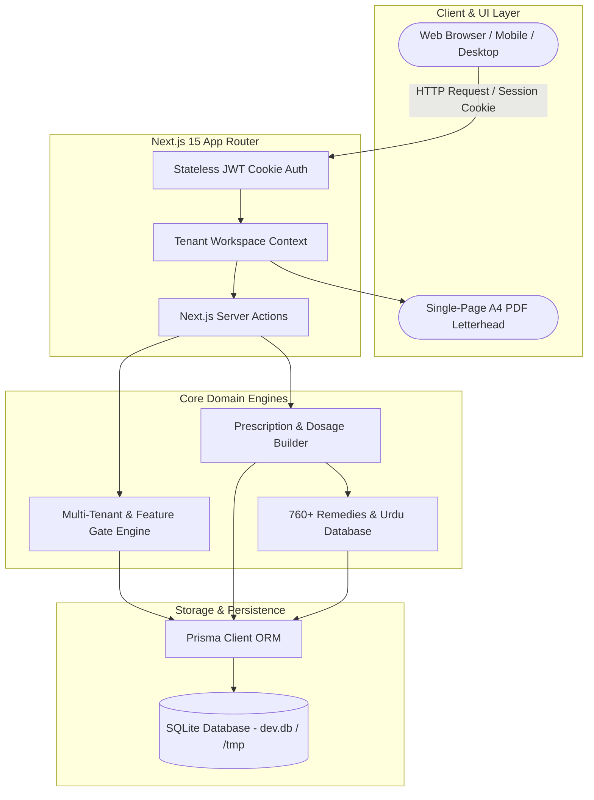

# ARCHITECTURE.md

> **System Architecture, Subsystem Data Flow & Invariants**
> This document outlines the technical design, component boundaries, runtime data flows, and architectural invariants of HomeoRx SaaS. AI agents must preserve these invariants during all code generation, refactoring, and feature additions.

---

## 1. System Overview
- **Project Purpose**: High-performance, multi-tenant Homeopathic EHR & Clinical Prescription Suite with bilingual Urdu/English support and luxury Single-Page A4 PDF print generation.
- **Architecture Pattern**: Full-Stack Next.js 15 (App Router) + Server Actions + Prisma ORM
- **Target Runtime / Platform**: Node.js / Vercel Serverless (Stateless Lambda) & Self-Hosted Environments

---

## 2. Component Topology & Data Flow

### Subsystem Breakdown

1. **Presentation & UI (`src/app/`, `src/components/`)**:
   - **App Router Structure**: Grouped under `(dashboard)` for protected routes (`/patients`, `/prescriptions`, `/medicines`, `/repertory`, `/admin`, `/clinic`, `/settings`).
   - **Bilingual Nastaliq Typography**: Unified token `.urdu-text` and `.font-nastaliq` utilizing Google Noto Nastaliq Urdu font for accurate RTL rendering.
   - **Clinical Letterhead Engine (`src/components/prescription-templates/`)**: Ultra-responsive single-page A4 prescription layout with luxury clinic header, dermatome pattern mapping, amber glass remedy bottle artwork, and dual-accent wave footer.

2. **Authentication & Session Subsystem (`src/lib/auth.ts`)**:
   - **Stateless Cryptographic Tokens**: HMAC-SHA256 digitally signed JWT cookies (`homeorx_session_token`) storing `{ doctorId, tenantId, role, email, name, exp }`.
   - **Cross-Lambda Ephemeral Resilience**: Allows independent Vercel serverless containers to authenticate requests without requiring shared SQLite session row lookups.

3. **Multi-Tenancy & Access Control (`src/lib/tenant.ts`, `src/lib/feature-gate.ts`, `src/lib/account-lifecycle.ts`)**:
   - **Tenant Scoping**: Enforces data isolation so individual clinic doctors can only query and mutate records belonging to their `tenantId`.
   - **Super Admin Global Authority**: Grants Super Administrators global visibility across all tenants and bypasses demo creation limits.
   - **Trial & Feature Lifecycle**: Enforces demo trial limits (e.g. daily prescription quotas, watermarks) and upgrade workflows.

4. **Persistence Layer (`prisma/`, `src/lib/db.ts`)**:
   - **ORM**: Prisma Client connected via dynamic SQLite datasource URLs (`/tmp/dev.db` on Vercel or local `./prisma/dev.db`).
   - **Self-Healing Schema Migrations**: Runtime `ensureDbSchema()` executes safe `ALTER TABLE` DDL checks on startup.
   - **Master Seeding**: Bundled binary seed (`src/lib/db-seed-binary.ts`) hydrates 760+ homeopathic remedies, potencies, dosages, frequencies, and Urdu instructions.

---

## 3. Core Invariants (Non-Negotiable Constraints)

1. **Stateless Cross-Instance Integrity**:
   - Never introduce stateful session tables or in-memory caches that assume a single long-lived Node.js process unless backed by persistent storage.
2. **Multi-Tenant Data Isolation**:
   - Doctor queries must always filter by `tenantId` unless the acting user has `role === "SUPER_ADMIN"`.
3. **Single-Page A4 Geometry**:
   - The prescription output sheet must strictly adhere to `minHeight: 272mm` and `maxHeight: 284mm`, with overflow hidden and `@media print` exact color adjustments.
4. **Bilingual Typography Integrity**:
   - Urdu instructions and medical terms must always render with Nastaliq typography and RTL directionality.

---

## 4. Technology Stack & Decision Rationale

| Category | Technology | Rationale / Role |
| :--- | :--- | :--- |
| Framework | Next.js 15 (App Router) | High-performance full-stack server actions & server-rendered React |
| UI & Styling | TailwindCSS + Lucide Icons | Responsive modern clinic UI with dark/light theme support |
| Database / ORM | Prisma + SQLite | Lightweight, zero-config relational database engine |
| Typography | Noto Nastaliq Urdu | Authentic calligraphic rendering for Urdu prescription instructions |
| Auth & Crypto | Web Crypto API (HMAC-SHA256) | Zero-dependency stateless cross-lambda session tokens |

---

## 5. Security & Isolation Boundaries
- **Cookie Security**: `homeorx_session_token` cookie configured with `httpOnly: true`, `sameSite: "lax"`, and cryptographic signature validation.
- **Input Validation**: All client payloads validated using Zod schemas (`src/lib/validations.ts`) before database execution.

